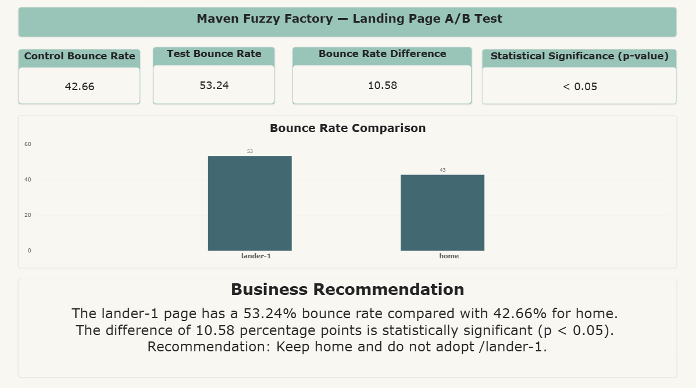

# Toy Store E-Commerce Database — Landing Page A/B Test

## Project Overview

This project analyzes a landing page A/B test using the Toy Store E-Commerce Database.

The analysis compares two landing pages:

- **Control:** `home`
- **Test:** `lander-1`

The main objective is to determine whether the test landing page performs better than the original landing page based on **bounce rate**.


## Business Objective

Determine whether the `lander-1` landing page performs better than the `home` landing page.

The primary metric used for evaluation is **bounce rate**.

The analysis uses SQL Server to identify the A/B test traffic and calculate bounce rates, Python to test statistical significance, and Power BI to present the results.

## Tools & Technologies

- **SQL Server** — Data exploration and A/B test analysis
- **Python** — Statistical analysis
- **Pandas** — Data handling
- **Matplotlib** — Data visualization
- **Power BI** — Dashboard development
- **Jupyter Notebook** — Analysis workflow

## Analysis Process

<!-- ```text -->
Raw CSV Data
     ↓
SQL Server
     ↓
Landing Page Identification
     ↓
Bounce Rate Calculation
     ↓
Python Statistical Analysis
     ↓
Power BI Dashboard
     ↓
Business Recommendation

## A/B Test Setup

| Group | Landing Page |
|---|---|
| Control | `home` |
| Test | `lander-1` |

The test period analyzed was from **June 19, 2012 to March 10, 2013**.


## Key Results

| Metric | `home` | `lander-1` |
|---|---:|---:|
| Sessions | 13,683 | 47,543 |
| Bounced Sessions | 5,837 | 25,310 |
| Bounce Rate | 42.66% | 53.24% |

The `lander-1` landing page had a **10.58 percentage-point higher bounce rate** than the `home` landing page.

## Statistical Significance

A two-proportion z-test was used to determine whether the difference in bounce rates was statistically significant.

- **Z-score:** approximately -21.81
- **P-value:** effectively 0
- **Significance level (α):** 0.05

Since the p-value is below the significance level, the difference in bounce rates is statistically significant.

## Business Recommendation

The `lander-1` landing page performed significantly worse than the original `home` landing page.

Its bounce rate was **53.24%**, compared with **42.66%** for `home`.

### Recommendation

**Keep the `home` landing page and do not adopt `lander-1`.**

## Dashboard

The Power BI dashboard summarizes the A/B test results, including bounce rates, the difference between the two landing pages, statistical significance, and the final business recommendation.



## Project Structure

<!-- ```text -->
Toy Store E-Commerce Database/
│
├── data/
│   ├── website_sessions.csv
│   ├── website_pageviews.csv
│   ├── orders.csv
│   ├── order_items.csv
│   ├── order_item_refunds.csv
│   └── products.csv
│
├── sql/
│   └── 01_Landing_Page_AB_Test.sql
│
├── notebooks/
│   └── 01_Landing_Page_AB_Test.ipynb
│
├── dashboard/
│   └── Landing_Page_AB_Test.pbix
│
├── images/
│   └── dashboard.png
│
├── README.md
├── requirements.txt
└── .gitignore

